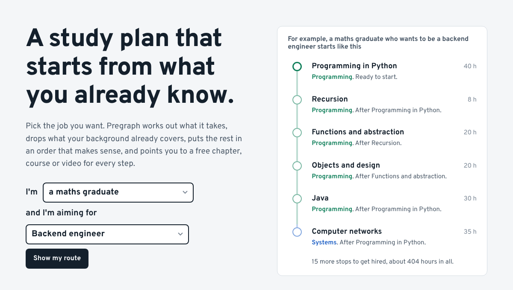
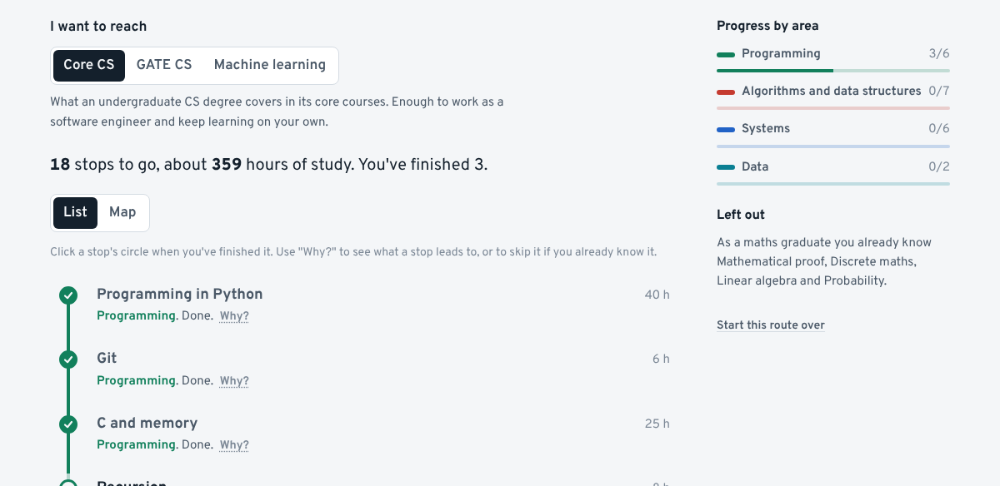
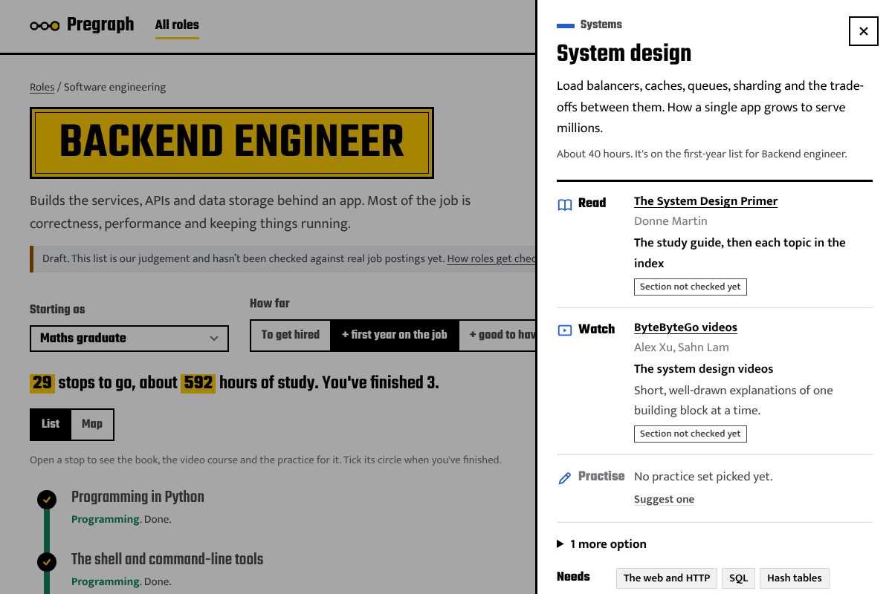

# Pregraph

A study plan that starts from what you already know.

I have a maths degree and had to work out computer science on my own. The material is all free. What I lost time on was everything around it: what a job actually needs, what I could skip, what order to learn the rest in, and how to know I'd really learned something.

Pregraph starts from a ticket: *From a maths graduate, To Backend engineer.* Each role lists what it needs in three tiers: to get hired, in the first year, and good to have. Pregraph keeps everything as a graph of concepts, tools and projects with their prerequisites. It drops what your background covers and puts the rest in order. Every stop comes with three picks: a good book or written guide, a good video course (YouTube, NPTEL, OCW) and, where there's a good one, somewhere to practise.







## What's here

- **Sixteen roles plus GATE CS:**
  - Software: software engineer, backend, frontend, full-stack, Android, QA/SDET, embedded.
  - Data: data analyst, data scientist, data engineer, ML engineer, AI/LLM engineer.
  - Infrastructure: DevOps/SRE, cloud, application support, security analyst.
- **Four starting points:** maths graduate, engineering graduate (not CS), CS or IT graduate, starting from zero.
- **One shared graph** of 75 concepts, 14 tools and 14 projects, linked to 141 resources, almost all of them free.
- **Read, watch, practise.** Each stop has one pick of each. Open a stop to see them, along with why it's on your route and what it leads to.
- **Ticking off progress.** What you finish counts for every role. Each stop can say why it's there, and you can skip what you already know.
- **A map of the route,** drawn by a layout algorithm written for this project.
- **Search** across concepts and the resources behind them ("ostep", "strang", "kafka").
- **No account.** Progress is saved in your browser.

Every role is a draft until its tiers have been checked against real job postings. [docs/ROLES.md](docs/ROLES.md) explains how, and `npm run evidence` does the counting.

The look is borrowed from the Mumbai local: yellow station boards, a ticket for picking your route, and routes drawn as train lines. Signs and headings are set in Teko, by the Indian Type Foundry in Ahmedabad. Reading text is set in Mukta, by Ek Type in Mumbai.

## How the order is worked out

1. Walk back from the role's targets through the prerequisites, and stop wherever your background already covers the ground.
2. Topologically sort what's left (Kahn's algorithm).
3. When several things could come next, start the longest chains first, but stay in the same area if something there is nearly as urgent.

The same TypeScript runs at build time and in the browser, so ticking a box re-plans instantly with no server. The details are in the [design notes](docs/SYSTEM_DESIGN.md).

## Run it

You need Node 22.23.4 or newer.

```bash
npm install
npm run dev                          # http://localhost:4321
npm test                             # engine, layout and search tests, including property tests
npm run validate                     # checks content/ for typos, unknown ids and prerequisite loops
npm run validate -- --gaps           # also lists stops missing a read, watch or practise pick
npm run evidence -- backend-engineer # counts tagged job postings for a role
npm run build                        # validate, then build the static site into dist/
```

## Deploying

It's a static site, so there's no server or database to run. It's hosted on Cloudflare Pages:

- Build command: `npm run build`
- Output folder: `dist`
- Node version: whatever `.nvmrc` says.

Every push to `main` deploys, and every other branch gets its own preview URL. `public/_headers` sets the caching. If the site ever moves to a custom domain, change `site` in `astro.config.mjs` and the sitemap line in `public/robots.txt`.

Before a release, run `npm run check-links` on your own machine. It tries every resource URL and lists the ones to look at.

## Adding to the graph

Concepts, tools and projects live in `content/concepts/`, one file per area:

```yaml
- id: docker
  title: Containers and Docker
  area: infra
  kind: tool                          # concept, tool or project
  summary: Packaging an app with everything it needs so it runs the same everywhere.
  hours: 12
  requires: [shell-tools]             # has to come first, pulled into plans
  resources:
    - resource: docker-docs           # an id from content/resources.yaml
      locator: "The getting-started guide, start to finish"
      why: "Short, official and kept up to date."   # optional, shown next to the pick
      verified: true                  # only once you've opened it and checked
```

Roles live in `content/roles.yaml`:

```yaml
- id: devops-engineer
  title: DevOps / site reliability engineer
  family: infra
  summary: Keeps software building, deploying and running.
  tiers:
    hire: [shell-tools, linux-admin, git, networking, docker, ci-cd, cloud-basics]
    firstYear: [kubernetes, observability, infrastructure-as-code]
    extra: [distributed-systems]
```

Run `npm run validate` afterwards.

Every resource in `content/resources.yaml` has a `medium`: `read`, `watch` or `practice`. Each stop shows the first free one of each medium as its pick.

The most useful contributions right now:
- Checking chapter and lecture references. About a quarter are checked so far; `npm run validate` says how many are left.
- Suggesting a video or practice pick where one is missing.
- Collecting job postings for a role.

## Layout

```
content/              the graph, the roles and the backgrounds, as YAML
research/postings/    hand-tagged job postings, one CSV per role
src/lib/graph.ts      the path engine
src/lib/layout.ts     layered graph layout for the map
src/lib/search.ts     search scoring
src/components/       role planner, stop panel and map (React), search box (plain TypeScript)
src/pages/            home, roles, concept pages
docs/                 design notes, how roles get checked, what this teaches, changelog
```

## Docs

- [System design](docs/SYSTEM_DESIGN.md): data model, algorithms, architecture, decisions
- [How roles get checked](docs/ROLES.md): turning a draft role into one backed by job postings
- [What building this teaches](docs/CONCEPTS.md): every technique used, with free places to learn it
- [Changelog](docs/CHANGELOG.md): what changed each week

Built with TypeScript, Astro, React, zod, Vitest and fast-check, and hosted on Cloudflare Pages.
