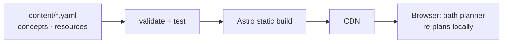

# Pregraph

**Learn a new field, starting from the one you know.**

Pregraph stores a subject as a graph of concepts and prerequisites. Tell it where you're coming from (say, a maths degree) and where you want to go (core computer science). It removes what you already know, orders the rest so every concept comes after its prerequisites, and points you to the exact chapter or lecture for each step — free resources first.

> Status: **v0 in progress.** First path: *Maths → Computer Science* (15 sample concepts; the full graph will be 80–150).

## How it works



1. **Backward search with pruning.** Walk back from your goals along prerequisites, stopping at anything you already know.
2. **Topological sort** (Kahn's algorithm) puts what's left in a valid order, with a stable tie-break.
3. **Frontier.** Shows what you can start right now.

The same TypeScript engine runs at build time and in the browser, so ticking a box re-plans instantly with no server.

## Docs

- [System design](docs/SYSTEM_DESIGN.md) — scope, data model, algorithm, architecture, storage, milestones, decisions
- [Concepts you'll learn](docs/CONCEPTS.md) — every technique used here and where to learn it

## Run it

Requires Node 22.23.4 or newer.

```bash
npm install
npm run dev        # http://localhost:4321
npm test           # path engine tests, including property-based tests on random graphs
npm run validate   # checks content/ for schema errors, unknown ids and prerequisite cycles
npm run build      # validate, then build the static site into dist/
```

## Project layout

```
content/            the learning graph, as YAML (this is the product)
src/lib/graph.ts    path engine: pruned backward search, topological sort, cycle detection
src/lib/schema.ts   content contract (zod)
src/lib/content.ts  loads + cross-checks content at build time
src/components/     PathPlanner — the only interactive island
src/pages/          index, /paths/[slug], /concepts/[id]
tests/              vitest + fast-check
```

## Adding content

Add a concept to the right file in `content/concepts/`:

```yaml
- id: operating-systems
  title: Operating Systems
  area: systems
  summary: Processes, scheduling, virtual memory, concurrency and file systems.
  hours: 50
  requires: [c-and-memory, computer-architecture]   # must come first
  recommends: [shell-tools]                         # nudges order only
  resources:
    - resource: ostep                               # id from content/resources.yaml
      locator: "Virtualization, Concurrency and Persistence"
      verified: true                                # only after you've checked it
```

Then run `npm run validate`. Every concept needs at least one free primary resource.

## Stack

TypeScript · Astro · React · zod · Vitest · fast-check · Cloudflare Pages (planned) · Cloudflare Workers + Neon Postgres (v1)
