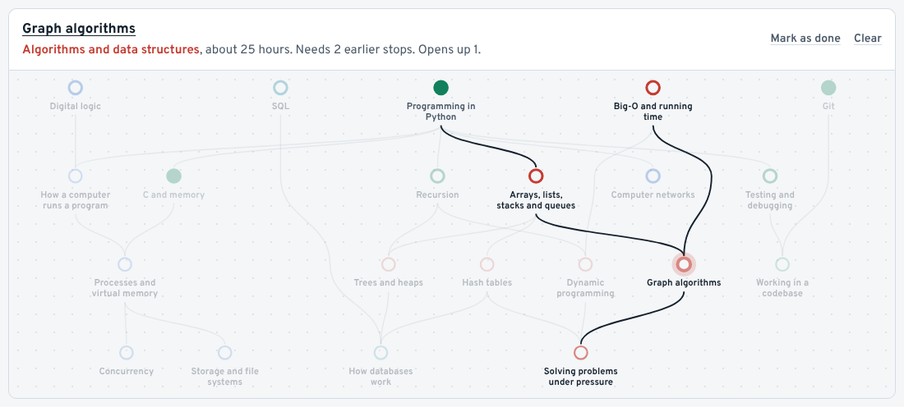

# Pregraph

A study plan that starts from what you already know.

I have a maths degree and had to work out computer science on my own. The material is all free. The hard part was knowing what to study, in what order, and from where. Pregraph keeps the subject as a graph of concepts and their prerequisites. You tell it your background and your goal, and it drops what you already know, puts the rest in order, and points you to the chapter or lecture that teaches each step.




## What's here

- Two routes, **Maths to computer science** and **Computer science from zero**, over one graph of 40 concepts and 31 free resources.
- Three goals to switch between: Core CS, GATE CS and Machine learning.
- Tick stops off as you go. Ask any stop why it's there, or skip it if you already know it.
- A map of the route, drawn by a layout algorithm written for this project.
- Search across concepts and the books and courses behind them ("ostep", "strang", "6.006").
- No account. Progress is saved in your browser.

## How the order is worked out

1. Walk back from your goal through the prerequisites, and stop wherever your background already covers the ground.
2. Topologically sort what's left (Kahn's algorithm).
3. When several things could come next, start the longest chains first, but stay in the same area if something there is nearly as urgent.

The same TypeScript runs at build time and in the browser, so ticking a box re-plans instantly with no server. The details are in the [design notes](docs/SYSTEM_DESIGN.md).

## Run it

You need Node 22.23.4 or newer.

```bash
npm install
npm run dev        # http://localhost:4321
npm test           # engine, layout and search tests, including property tests on random graphs
npm run validate   # checks content/ for typos, unknown ids and prerequisite loops
npm run build      # validate, then build the static site into dist/
```

## Adding to the graph

Concepts live in `content/concepts/`, one file per area:

```yaml
- id: concurrency
  title: Concurrency
  area: systems
  summary: Threads, locks, condition variables and the bugs they cause.
  hours: 20
  requires: [os-processes-memory]      # has to come first, pulled into plans
  recommends: [shell-tools]            # nice to have first, only affects order
  resources:
    - resource: ostep                  # an id from content/resources.yaml
      locator: "Part II, Concurrency"
      verified: true                   # only once you've opened it and checked
```

Run `npm run validate` afterwards. Every concept needs at least one free resource marked as the place to start.

Every chapter and lecture reference is currently `verified: false`. Checking them is the most useful contribution right now.

## Layout

```
content/            the graph, as YAML
src/lib/graph.ts    the path engine
src/lib/layout.ts   layered graph layout for the map
src/lib/search.ts   search scoring
src/components/     planner and map (React), search box (plain TypeScript)
src/pages/          home, routes, concept pages
docs/               design notes, what the project teaches, changelog
```

## Docs

- [System design](docs/SYSTEM_DESIGN.md): data model, algorithms, architecture, decisions
- [What building this teaches](docs/CONCEPTS.md): every technique used, with free places to learn it
- [Changelog](docs/CHANGELOG.md): what changed each week

Built with TypeScript, Astro, React, zod, Vitest and fast-check. It'll be hosted on Cloudflare Pages.
