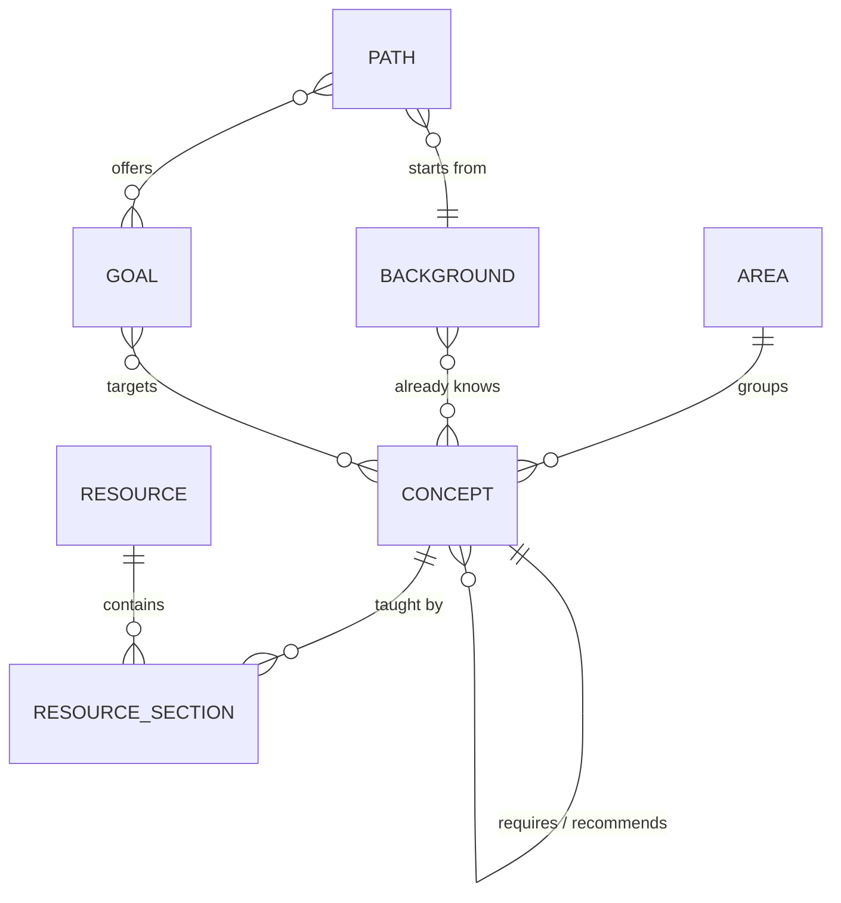
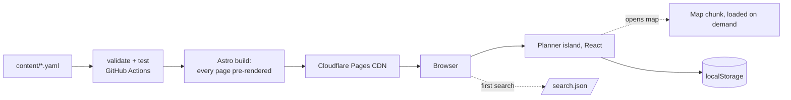
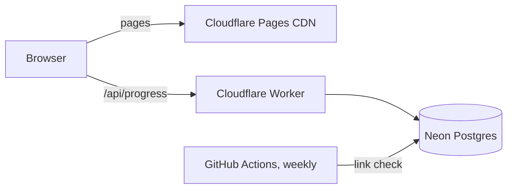

# Pregraph: system design

Last updated after week 5 (November 2026). I keep this file in step with the code, so if something here disagrees with `src/`, the code wins and this file has a bug.

The companion file, [CONCEPTS.md](CONCEPTS.md), explains each technique used here and where to learn it.

## 1. The problem

Say you have a maths degree and want to learn computer science on your own. The material is all free and all online. What's missing is someone to tell you:

1. what to study, given what you already know,
2. in what order, and
3. where to learn each piece, down to the chapter or lecture rather than "take this course".

roadmap.sh, OSSU and teachyourselfcs.com each give one path for everybody. Pregraph gives you a path that starts from your background.

## 2. What it does

You pick where you're coming from (a maths degree, or nothing) and where you're going (Core CS, GATE CS or machine learning). Pregraph stores the subject as a graph of concepts and prerequisites. It drops what your background covers, orders what's left so every concept comes after the things it depends on, and links each step to the free chapter or lecture that teaches it. You tick stops off as you go and the plan updates straight away.

## 3. Scope

Done so far:

- Two routes, *Maths to CS* and *CS from zero*, over one shared graph of 40 concepts and 31 resources.
- Three goals per route: Core CS, GATE CS and Machine learning.
- A planner with progress, "why is this here?", skipping and progress by area.
- A map view of the route, drawn by a layout algorithm in `src/lib/layout.ts`.
- Search over concepts and the resources behind them.
- Progress saved in the browser. No accounts.

Next:

- Week 6: deploy to Cloudflare Pages, add privacy-friendly analytics, share with the first users.
- Later (v1): accounts and sync across devices, a weekly dead-link checker.
- Later (v2): a short adaptive test instead of ticking boxes, ratings, more routes.

Not planned: hosting course material (Pregraph links, it never copies), and paid courses in the main path. Paid books can appear, marked as paid, as optional extras.

## 4. Requirements

| | Requirement | Target |
|---|---|---|
| Correctness | Every stop comes after all its hard prerequisites | Checked by property tests on random graphs |
| Content | Every concept has at least one free resource | Build fails otherwise |
| Speed | First page load | Under 1 s on 4G; HTML from a CDN edge |
| Speed | Re-plan after a tick | Under one frame (16 ms), in the browser |
| Weight | JavaScript on content pages | About 1 KB (the search box) |
| Cost | Hosting | Free; a domain is about ₹1,000 a year if wanted |
| Reliability | Site works if any backend is down | There is no backend yet |

## 5. Data model

The content is the product, so it lives in Git as YAML and gets reviewed like code.



| File | What's in it |
|---|---|
| `content/areas.yaml` | Topic areas, in display order. Each gets a colour in `src/styles/global.css`. |
| `content/concepts/*.yaml` | One file per area. A concept has an `id`, `title`, `area`, `summary`, `hours`, `requires` (hard prerequisites), `recommends` (soft ones) and `resources`. |
| `content/resources.yaml` | Books, courses and sites: title, author, URL, whether it's free, and an optional `short` name people actually use ("OSTEP", "CLRS"). |
| `content/backgrounds.yaml` | What a kind of learner already knows, as a list of concept ids. |
| `content/goals.yaml` | A goal is a list of target concepts. |
| `content/paths.yaml` | A route: one background plus the goals you can switch between. |

A resource section says which part of a resource teaches a concept (`locator: "Part I, Virtualization"`), its role (`primary`, `alternative` or `deep-dive`), and `verified`. Every section starts as `verified: false` until someone opens the resource and checks the chapter numbers. Concept pages say "Section not checked yet" for those.

Hard and soft prerequisites behave differently, and that's deliberate. A hard one (`requires`) decides what you need: it gets pulled into your plan. A soft one (`recommends`) only affects order, and only when both concepts are already in the plan. That keeps plans short. Git is a soft prerequisite of C, for example: it's worth learning first, but nobody needs Git to understand pointers.

Ids appear in URLs, so once the site is live a concept id shouldn't change.

## 6. The path engine

`src/lib/graph.ts`. Pure functions with no I/O, so the same code runs at build time (to render pages) and in the browser (to re-plan when you tick something).

Inputs: the concepts, a set of goal concepts `T`, and a set of known concepts `K` (your background plus anything you skipped).

### 6.1 What do I still need?

Walk backwards from each goal along hard prerequisites. When you reach something you already know, stop and don't look behind it, because knowing it means you're past its prerequisites too.

```
needed = {}
stack = T minus K
while stack is not empty:
    v = pop(stack)
    if v in needed: continue
    add v to needed
    for each hard prerequisite u of v:
        if u not in K: push u
```

This is O(V + E), and the early stop is the whole trick. A maths graduate's walk stops at *Discrete maths*, so nothing behind it ever appears.

### 6.2 In what order?

Kahn's algorithm on the needed concepts, counting both hard and soft edges. If the soft edges happen to form a cycle, they're dropped and hard edges alone decide. Hard edges can't form a cycle because the build rejects that (6.4).

The interesting part is what to do when several concepts are ready at once. My first version picked the shortest one, and it put Git and Big-O ahead of learning to program, which made no sense. Two things pull against each other here:

- **Urgency.** Each concept gets a *critical path* score: its own hours plus the longest chain of hours waiting behind it. Starting the long chains first is the classic list-scheduling rule, and it stops one long chain from holding up the end. Soft edges count here too. Otherwise a short soft prerequisite like Git looks unimportant and blocks the long C → operating systems chain behind it.
- **Staying in one area.** A plan that bounces between topics every step is hard to follow.

So the rule is: stay in the current area if something there is at least half as urgent as the most urgent ready concept (`STAY_RATIO = 0.5`). Otherwise jump to the most urgent one. Ties go by id, so output is stable and testable.

Picking the next concept is a linear scan of the ready list, so the whole sort is O(V² + E). At a few hundred concepts that's well under a millisecond. If it ever had to handle tens of thousands, I'd keep one heap per area.

### 6.3 Explaining the plan

Each step in the result also carries:

- `waitingOn`: hard prerequisites still in the plan,
- `unlocks`: later steps that need it,
- `neededFor`: which goal targets pulled it in. This runs the pruned walk once per target, so it's O(T · (V + E)). That's still nothing at this size.

The planner turns those into the "Why?" text: "Processes and virtual memory, Concurrency and Storage and file systems need it, on the way to Core CS."

### 6.4 Build-time checks

`npm run validate` (which runs before every build and in CI) fails if:

- any YAML file breaks the schema (zod),
- any id is referenced but never defined,
- hard prerequisites contain a cycle. This is found with a three-colour DFS, and the error prints the cycle, e.g. `a → b → c → a`,
- a concept has no free primary resource,
- an area, background, goal or path refers to something that doesn't exist.

Bad content gets caught in CI, not by someone using the site.

## 7. The map

`src/lib/layout.ts` draws the route as a layered graph. I wrote it rather than pulling in dagre or React Flow. The map only needs a fraction of what those do, the code is about 200 lines, and it's the most mathematical part of the project, so it's worth understanding properly.

It's a cut-down version of the Sugiyama method:

1. **Rows.** Each concept goes one row below its deepest prerequisite (longest path from a source), so every edge points down.
2. **Long edges.** An edge that skips rows gets an invisible "dummy" node in each row it passes through, so it can curve around stops instead of through them.
3. **Order within rows.** Sweep down and then up, eight times, moving each node to the average position of its neighbours in the row above or below (the barycentre heuristic). After each sweep, count crossings and keep the best ordering seen. Minimising crossings exactly is NP-hard, so this is the standard compromise. Keeping the best ordering seen guarantees the result never has more crossings than the starting order, and there's a property test for that.
4. **Coordinates.** Start with centred rows, then make a few passes that pull each node towards the average x of its neighbours and push apart anything that would overlap. Edges come out much straighter than with plain centring.

Edges are drawn as vertical S-curves through the dummy points. They start under a stop's label and end at the top of the next dot. Labels have a paper-coloured outline, so lines passing behind them don't hurt legibility.

Selecting a stop walks up and down from it and dims everything that isn't on its chain.

The map component and the layout code are split into their own file. They only download when someone switches to the map.

## 8. Search

`src/lib/search.ts` plus `src/components/Search.astro`.

With 40 concepts, and a few hundred at most, a scored linear scan is instant, so there's no index library. At build time `/search.json` is written with each concept's title, area, summary and the titles, short names and authors of its resources. That's about 11 KB, fetched the first time someone focuses the search box.

Scoring: every word in the query must match somewhere. A match at the start of a title word scores 10, elsewhere in the title 6, in a resource name or author 3, in the summary 1, plus a bonus if the title starts with the first word. "ostep" finds the three operating systems concepts, and "strang" finds linear algebra.

The search box is plain TypeScript, not React. It's on every page, so it costs about 1 KB instead of a framework runtime.

## 9. Front end

### Architecture



Every page is plain HTML built at deploy time. The planner is the one React island, on route pages only. Concept pages and the home page ship no framework at all.

### What ships

Measured from `npm run build`, gzipped:

| Page | HTML | JavaScript |
|---|---|---|
| Home | 4.7 KB | about 1 KB inline (search) |
| Concept page | about 3 KB | about 1 KB inline (search) |
| Route page | 9.4 KB | 66 KB React runtime + 4 KB planner; +3 KB when the map opens |

The React runtime is most of the weight. Swapping in Preact through `@astrojs/preact` with its React compatibility layer would cut about 55 KB without changing component code. I'm keeping React for now because it's what I want to practise, but it's the obvious first move if the route page ever feels slow.

Fonts are self-hosted (Overpass, from `@fontsource-variable`). There's no request to Google and no layout shift from a late font.

### Look and feel

The design borrows from transit maps, because that's what a learning path is: each area is a coloured line, each concept is a stop, and your route fills in as you finish stops. It uses one typeface, Overpass, which is modelled on US highway signage. Colours are cool paper and navy ink, plus one colour per area, checked in both light and dark mode. The route line is the one loud element, and everything else stays quiet. There are no cards, no gradients and no all-caps labels.

Tokens live in `src/styles/global.css`. Area colours are set once, with `[data-area="systems"] { --line: … }`, and everything inside picks them up.

### Planner state

```ts
{ goal?: string, view?: 'list' | 'map', known: string[], done: string[] }
```

This is stored per route under `pregraph:<slug>` in localStorage. Every read and write is wrapped in `try/catch`, because private windows can block storage. The selected goal is also mirrored into the URL (`?goal=gate-cs`), so a link to a GATE plan opens as a GATE plan.

The planner reads storage in an effect after the first render, so the server HTML and the first client render match.

## 10. Accounts and sync (v1, not built)



Only user data goes in Postgres. Content stays in Git.

```sql
create table users (
  id          uuid primary key default gen_random_uuid(),
  email       text unique not null,
  created_at  timestamptz not null default now()
);

create type progress_status as enum ('known', 'done');

create table progress (
  user_id     uuid not null references users(id) on delete cascade,
  concept_id  text not null,
  status      progress_status not null,
  updated_at  timestamptz not null default now(),
  primary key (user_id, concept_id)
);

create table link_checks (
  url         text primary key,
  last_status int,
  last_ok_at  timestamptz,
  checked_at  timestamptz not null default now()
);
```

A progress row is roughly 60 to 100 bytes with its index. 10,000 users × 150 concepts is 1.5 million rows, around 150 to 200 MB, well inside Neon's free 1 GB.

localStorage stays the source of truth while offline. On sign-in, local and server progress are merged per concept, and the newer `updated_at` wins.

Workers don't sleep the way free "always-on" hosts do. Neon suspends after about five idle minutes and wakes in a few hundred milliseconds, but only sign-in and sync would wait on it, never a page load.

## 11. Repository layout

```
content/                 the graph, as YAML
src/lib/graph.ts         path engine: pruned walk, ordering, cycle detection
src/lib/layout.ts        layered layout for the map
src/lib/search.ts        scoring for search
src/lib/schema.ts        content contract (zod)
src/lib/content.ts       loads and cross-checks content at build time
src/components/          PathPlanner, RouteMap (React), Search (plain TS)
src/pages/               home, /paths/[slug], /concepts/[id], /search.json, 404
src/styles/              tokens, route, planner, map
tests/                   vitest + fast-check
scripts/validate.ts      npm run validate
```

## 12. Milestones

| Week | What | Status |
|---|---|---|
| 1 | Design, scaffold, engine and tests | Done |
| 2–3 | Graph grown to 40 concepts, 3 goals, 2 routes | Done (locators still to verify) |
| 4 | Redesign; planner: goals, "why", skipping, progress by area | Done |
| 5 | Map view with own layout; search | Done |
| 6 | Deploy on Cloudflare Pages, analytics, first users | Next |
| 7–8 | Verify every locator, fix what users report, third route | |
| later | v1 accounts and sync, link checker; v2 adaptive test | |

## 13. Decisions

| Decision | Why | Revisit when |
|---|---|---|
| Static site, no backend | Free, fast, nothing to break | People ask for sync across devices |
| Astro with React islands | HTML first, good for search engines, React only where needed | Most pages become interactive |
| Content as YAML in Git | Diffs, history, pull requests and CI checks for free | Non-developers want to edit (then a small editor that writes the same files) |
| Same engine at build time and in the browser | One implementation, one set of tests | — |
| Hard vs soft prerequisites | Hard decides what's needed, soft only nudges order, so plans stay short | — |
| Critical path plus area stickiness for ordering | Shortest-first gave silly orders; pure critical path jumped between topics | Users say the order feels wrong (tune `STAY_RATIO`) |
| Own graph layout, not dagre / React Flow | Small, fits exactly, and worth understanding | The map needs zoom, drag, editing |
| Own search, not Pagefind | 40–300 short records; a 1 KB scorer beats an index | Content pages get long text worth searching |
| localStorage before accounts | Nothing to sign up for, no personal data to protect | v1 |

## 14. Risks

- **Curation is the real cost.** Every locator is unverified until someone checks it. Plan: one route done properly before adding more, and later, an AI drafts while a human reviews.
- **A wrong prerequisite makes a bad plan.** Concepts are kept small, there are tests on the real graph, and the "Why?" panel makes odd orderings easy to spot.
- **Links rot.** Most links point at stable hosts (university sites, authors' own sites, OCW), and the v1 link checker will flag the rest.
- **"Why not just ask a chatbot?"** A chatbot gives a different plan every time and can't track your progress. Pregraph's graph is reviewed, stable and checkable. A chatbot could sit on top to explain a concept, but the graph should decide the order and the sources.

## 15. Open questions

- Licences: MIT for the code? CC BY-SA for the content?
- NPTEL courses for the GATE goal. They need checking course by course before going in.
- `hours` are my estimates for now. With real users, the time between "started" and "done" would give better numbers.
