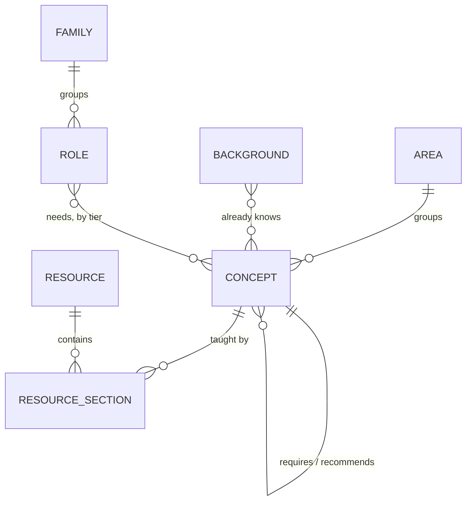
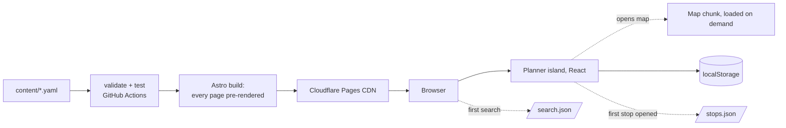
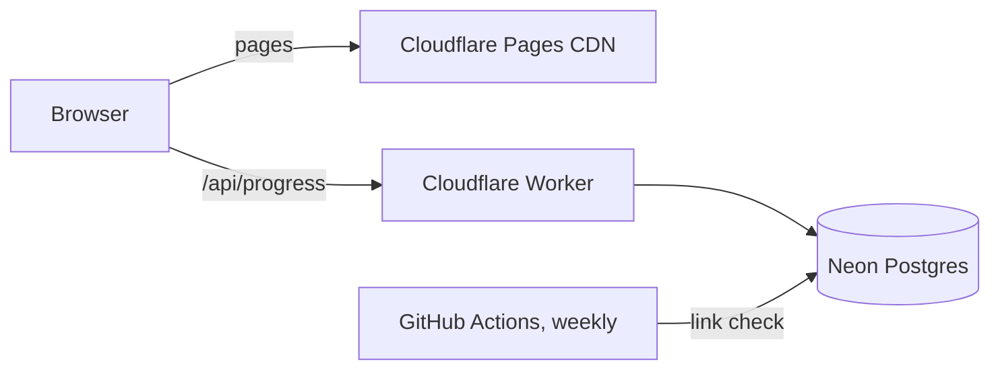

# Terminus: system design

Last updated after week 7: more roles, book and video picks for every stop, and the Mumbai local redesign (November 2026). I keep this file in step with the code, so if something here disagrees with `src/`, the code wins and this file has a bug.

The companion file, [CONCEPTS.md](CONCEPTS.md), explains each technique used here and where to learn it.

## 1. The problem

Say you have a maths degree and want a job as a backend engineer. The material is all free and all online. What's missing is someone to tell you:

1. what the job actually needs,
2. which of that you already know and can skip,
3. what order to learn the rest in,
4. where to learn each piece, down to the chapter or lecture, and
5. how to tell that you've really learned it.

roadmap.sh has role-based lists and OSSU has a full curriculum, but both give everybody the same path. Terminus's path starts from your background. Point 5 isn't built yet; it's the next big piece (section 12).

## 2. What it does

You say where you're starting from and which job you want: "I'm a maths graduate and I'm aiming for Backend engineer". Each role lists what it needs in three tiers: to get hired, in the first year, and good to have. Terminus stores everything as a graph of concepts, tools and projects with prerequisites. It drops what your background covers, orders what's left so every stop comes after the things it depends on, and links each step to a free chapter, course or video. You tick stops off as you go, and the plan updates straight away. Your progress is shared across roles, so SQL you finished while looking at data analysis stays finished when you look at backend.

## 3. Scope

Done so far:

- Forty-one roles and five exams, over one shared graph: 108 concepts, 67 tools, 16 projects and 324 resources, plus a tools page with 78 of them on twelve shelves and a practice page with 43 places to practise.
- For every stop, a pick to read, a pick to watch (YouTube, NPTEL, OCW or Coursera) and, where there's a good one, a pick to practise with.
- A panel that opens on any stop, in the list or on the map, with those picks and what the stop needs and leads to.
- Four backgrounds: maths graduate, engineering graduate (not CS), CS or IT graduate, and starting from zero.
- A planner with a background picker, tiers, progress, "why is this here?", skipping and progress by area.
- A map view of the route, drawn by a layout algorithm in `src/lib/layout.ts`.
- Search over concepts and the resources behind them.
- Progress saved in the browser. No accounts.

Next:

- Evidence for the first two roles (SDE, backend) from real job postings. The process is in [ROLES.md](ROLES.md).
- Deploy to Cloudflare Pages, add privacy-friendly analytics, share with the first users.
- Check yourself: a few questions per concept, used to test out of a stop, to finish one, and for spaced review.
- Depth: a short page per concept with its own explanation, a worked example and common traps, built to one template.
- Later: more role families next to tech (business analyst, product manager, digital marketing, finance). Accounts and sync. A dead-link checker.

Not planned:
- Hosting course material. Terminus links, it never copies.
- Paid courses in the main path. Paid books can appear, marked as paid, as optional extras.
- Regulated professions (medicine, law, chartered accountancy and so on). Those are learned through degrees and licences, not free resources. If they ever appear, it'll be as "here's the official route" with a link.
- Every job at once. The engine doesn't care about the field, but each role needs real curation. Roles get added in families that share most of their concepts, so each new one is cheap.

## 4. Requirements

| | Requirement | Target |
|---|---|---|
| Correctness | Every stop comes after all its hard prerequisites | Checked by property tests on random graphs |
| Content | Every concept has at least one free resource | Build fails otherwise |
| Speed | First page load | Under 1 s on 4G; HTML from a CDN edge |
| Speed | Re-plan after a tick | Under one frame (16 ms), in the browser |
| Weight | JavaScript on content pages | About 1 KB (the search box) |
| Cost | Hosting | Free; a domain is about ₹1,000 a year if wanted |
| Reliability | Site works if any backend is down | There is no backend yet |

## 5. Data model

The content is the product, so it lives in Git as YAML and gets reviewed like code.



| File | What's in it |
|---|---|
| `content/areas.yaml` | Topic areas, in display order. Each gets a colour in `src/styles/global.css`. |
| `content/concepts/*.yaml` | One file per area. Each entry has an `id`, `title`, `area`, `kind`, `summary`, `hours`, `requires` (hard prerequisites), `recommends` (soft ones) and `resources`. `kind` is `concept` (something to understand), `tool` (something to get fluent in, like Docker or React) or `project` (something to build and show). The engine treats all three the same; the interface labels them. |
| `content/resources.yaml` | Books, courses and sites: title, author, URL, whether it's free, its `medium` (`read`, `watch` or `practice`), and an optional `short` name people actually use ("OSTEP", "CLRS", "NPTEL DBMS"). |
| `content/backgrounds.yaml` | What a kind of learner already knows, as a list of concept ids, plus a `phrase` for the home page sentence ("a maths graduate") and a `group` (`stem`, `other` or `none`) that decides where it sits in the picker. Nothing is preselected: with no background chosen, the planner shows the full route. |
| `content/families.yaml` | Groups of roles: software, data, infrastructure, exams. |
| `content/tool-groups.yaml` | The shelves on the tools page (languages, frameworks, databases, BI, DevOps) and which concepts sit on each, in order. A "tool" here is anything people come to learn on its own, so Python and SQL count even though their `kind` is `concept`. |
| `content/practice-groups.yaml` | The groups on the practice page and the practice resources in each. Which stops a resource tests is worked out from the concept files, so it can't drift. |
| `content/roles.yaml` | A role (or an exam): `title`, `family`, `summary`, and `tiers` with three lists of concept ids: `hire`, `firstYear` and `extra`. An optional `evidence` block records the job postings the tiers are based on. Without it the role page says "Draft". |
| `research/postings/*.csv` | Hand-collected, hand-tagged job postings, one file per role. `npm run evidence -- <role>` turns them into counts. See [ROLES.md](ROLES.md). |

A resource section says which part of a resource teaches a concept (`locator: "Part I, Virtualization"`), its role (`primary`, `alternative` or `deep-dive`), an optional one-line `why`, and `verified`.

**Picks.** Each stop shows one pick per medium: something to read, something to watch, something to practise with. The pick is the first free section of that medium marked `primary`, or failing that `alternative`. Deep dives and paid resources are never the pick; they appear under "more options". This lives in `picksFor` in `src/lib/schema.ts`, so the concept page, the panel and the tests all agree. `npm run validate -- --gaps` lists the stops still missing a pick. Right now that's 173 of 177 with something to read, 139 with something to watch and 60 with something to practise. The site says "No video course picked yet" and links to a pre-filled GitHub issue, rather than hiding the gap. Every section starts as `verified: false` until someone opens the resource and checks the chapter numbers. Concept pages say "Section not checked yet" for those. `npm run check-sections` (run on your own machine) loads each unchecked resource and looks for the names in its locator, then sorts the sections into likely fine, worth a look, numbers only, and didn't load. It never sets `verified` itself: that stays a person's call.

Hard and soft prerequisites behave differently, and that's deliberate. A hard one (`requires`) decides what you need: it gets pulled into your plan. A soft one (`recommends`) only affects order, and only when both concepts are already in the plan. That keeps plans short. Git is a soft prerequisite of C, for example: it's worth learning first, but nobody needs Git to understand pointers.

Ids appear in URLs, so once the site is live a concept id shouldn't change.

One known gap: prerequisites are all "and", never "or". A frontend learner really needs *a* first language, which could be JavaScript, but `linear-structures` requires `programming-basics` (Python), so a frontend route includes both. Supporting "any one of these" would turn the backward walk into a choice problem (pick the cheapest option given what you know). It's worth doing once enough routes hit it.

## 5a. Roles

A role is just a set of targets, so the engine needed no changes. Tiers are cumulative: "first year" means hire plus first year. The "How far" switch on the role page picks the tier.

Where the tiers come from matters more than the code. Every role starts as a draft. To turn a draft into something defensible, collect about 50 real postings for the role (India, 0–2 years), tag each with concept ids, and run `npm run evidence`. It prints how often each concept is asked for, a suggested tier (at least half the postings: hire; a fifth to a half: first year; less: good to have), and where that differs from the current list. A human makes the final call and writes down why when it goes against the numbers. Postings rarely mention data structures and algorithms, for example, but interviews test them.

## 6. The path engine

`src/lib/graph.ts`. Pure functions with no I/O, so the same code runs at build time (to render pages) and in the browser (to re-plan when you tick something).

Inputs: the concepts, a set of target concepts `T` (a role's tiers, up to the one you picked), and a set of known concepts `K` (your background plus anything you skipped).

### 6.1 What do I still need?

Walk backwards from each target along hard prerequisites. When you reach something you already know, stop and don't look behind it, because knowing it means you're past its prerequisites too.

```
needed = {}
stack = T minus K
while stack is not empty:
    v = pop(stack)
    if v in needed: continue
    add v to needed
    for each hard prerequisite u of v:
        if u not in K: push u
```

This is O(V + E), and the early stop is the whole trick. A maths graduate's walk stops at *Discrete maths*, so nothing behind it ever appears.

### 6.2 In what order?

Kahn's algorithm on the needed concepts, counting both hard and soft edges. If the soft edges happen to form a cycle, they're dropped and hard edges alone decide. Hard edges can't form a cycle because the build rejects that (6.4).

The interesting part is what to do when several concepts are ready at once. My first version picked the shortest one, and it put Git and Big-O ahead of learning to program, which made no sense. Two things pull against each other here:

- **Urgency.** Each concept gets a *critical path* score: its own hours plus the longest chain of hours waiting behind it. Starting the long chains first is the classic list-scheduling rule, and it stops one long chain from holding up the end. Soft edges count here too. Otherwise a short soft prerequisite like Git looks unimportant and blocks the long C → operating systems chain behind it.
- **Staying in one area.** A plan that bounces between topics every step is hard to follow.

So the rule is: stay in the current area if something there is at least half as urgent as the most urgent ready concept (`STAY_RATIO = 0.5`). Otherwise jump to the most urgent one. Ties go by id, so output is stable and testable.

Picking the next concept is a linear scan of the ready list, so the whole sort is O(V² + E). At a few hundred concepts that's well under a millisecond. If it ever had to handle tens of thousands, I'd keep one heap per area.

### 6.3 Explaining the plan

Each step in the result also carries:

- `waitingOn`: hard prerequisites still in the plan,
- `unlocks`: later steps that need it,
- `neededFor`: which role targets pulled it in. This runs the pruned walk once per target, so it's O(T · (V + E)). That's still nothing at this size.

The planner turns those into the "Why?" text. For example: "It's part of what it takes to get hired as a backend engineer, and Building a REST API also needs it."

### 6.4 Build-time checks

`npm run validate` (which runs before every build and in CI) fails if:

- any YAML file breaks the schema (zod),
- any id is referenced but never defined,
- hard prerequisites contain a cycle. This is found with a three-colour DFS, and the error prints the cycle, e.g. `a → b → c → a`,
- a concept has no free primary resource,
- an area, background, family or role refers to something that doesn't exist,
- a role lists the same concept in two tiers.

Bad content gets caught in CI, not by someone using the site.

## 6a. The stop panel

Click any stop, in the list or on the map, and a panel slides in from the right (a full-screen sheet on phones). It shows what the stop is, why it's on your route, the three picks, other options, what it needs and what it opens up (each one clickable), and buttons to mark it done or skip it. The URL hash follows the panel (`/roles/backend-engineer#system-design`), so a link can open straight to one stop.

The panel's data comes from `/stops.json`, built at deploy time from the same `stopDetails()` the concept pages use. It's fetched the first time someone opens a stop, so a role page doesn't carry every resource in its HTML. It's 18 KB gzipped for all 103 stops, and cached after that.

The full concept pages stay, for search engines and for links from elsewhere.

## 6b. Tools

Not everyone wants a whole job. Someone already working may only need Redis, or Power BI, or Go. `/tools` lists everything on the shelves in `content/tool-groups.yaml`, with hours, which of the three picks exist, and what comes first. Each tool page (`/tools/redis`) shows the picks, then the same planner as a role page, with the tool as its only target. There's no new engine code: a tool is a role with one target and one tier. The planner takes `goal="tool"` to change its wording, and it shares the same saved progress, so finishing Java on a role page counts on the Spring Boot page too. Search results for tools open the tool page.

## 7. The map

`src/lib/layout.ts` draws the route as a layered graph. I wrote it rather than pulling in dagre or React Flow. The map only needs a fraction of what those do, the code is about 200 lines, and it's the most mathematical part of the project, so it's worth understanding properly.

It's a cut-down version of the Sugiyama method:

1. **Rows.** Each concept goes one row below its deepest prerequisite (longest path from a source), so every edge points down.
2. **Long edges.** An edge that skips rows gets an invisible "dummy" node in each row it passes through, so it can curve around stops instead of through them.
3. **Order within rows.** Sweep down and then up, eight times, moving each node to the average position of its neighbours in the row above or below (the barycentre heuristic). After each sweep, count crossings and keep the best ordering seen. Minimising crossings exactly is NP-hard, so this is the standard compromise. Keeping the best ordering seen guarantees the result never has more crossings than the starting order, and there's a property test for that.
4. **Coordinates.** Start with centred rows, then make a few passes that pull each node towards the average x of its neighbours and push apart anything that would overlap. Edges come out much straighter than with plain centring.

Edges are drawn as vertical S-curves through the dummy points. They start under a stop's label and end at the top of the next dot. Labels have a paper-coloured outline, so lines passing behind them don't hurt legibility.

Selecting a stop walks up and down from it and dims everything that isn't on its chain.

The map component and the layout code are split into their own file. They only download when someone switches to the map.

## 8. Search

`src/lib/search.ts` plus `src/components/Search.astro`.

With 40 concepts, and a few hundred at most, a scored linear scan is instant, so there's no index library. At build time `/search.json` is written with each concept's title, area, summary and the titles, short names and authors of its resources. That's about 11 KB, fetched the first time someone focuses the search box.

Scoring: every word in the query must match somewhere. A match at the start of a title word scores 10, elsewhere in the title 6, in a resource name or author 3, in the summary 1, plus a bonus if the title starts with the first word. "ostep" finds the three operating systems concepts, and "strang" finds linear algebra.

The search box is plain TypeScript, not React. It's on every page, so it costs about 1 KB instead of a framework runtime.

## 9. Front end

### Architecture



Every page is plain HTML built at deploy time. The planner (with its panel) is the one React island, on role and tool pages only. Concept pages and the home page ship no framework at all.

### What ships

Measured from `npm run build`, gzipped:

| Page | HTML | JavaScript |
|---|---|---|
| Home | 5.8 KB | about 1.5 KB inline (search, picker) |
| Concept page | 4.6 KB | about 1 KB inline (search) |
| Role page | 11.8 KB | 66 KB React runtime + 6.4 KB planner and panel; +2.9 KB when the map opens; +18 KB of stop data on the first panel |

Fonts are the other cost: about 80 KB of woff2 on a first visit, cached after that. That's Teko's variable weight axis (15 KB for Latin) plus three weights of Mukta (about 21 KB each).

The React runtime is most of the weight. Swapping in Preact through `@astrojs/preact` with its React compatibility layer would cut about 55 KB without changing component code. I'm keeping React for now because it's what I want to practise, but it's the obvious first move if the role page ever feels slow.

Fonts are self-hosted (Overpass, from `@fontsource-variable`). There's no request to Google and no layout shift from a late font.

### Look and feel

The design borrows from the Mumbai local, because a learning path really is a train line:

- **Station boards.** Each page's own name sits on a yellow board with black condensed capitals, like a station name board. There's one per page and nowhere else, so it stays special.
- **The ticket.** The home page picker is a ticket: *From* your background *To* the role, with a perforated yellow stub holding "Plan my route".
- **Train lines.** A route is a thick line with a station for every stop. The line takes the colour of each stop's area and turns solid as you finish stops. Projects get square stations.
- **Type.** Two Indian typefaces. Signs, headings and station names are in Teko, by the Indian Type Foundry in Ahmedabad. Reading text is in Mukta, by Ek Type in Mumbai. Teko is self-hosted from `src/assets/fonts` with its own `@font-face`, which sets `size-adjust` and the ascent and descent overrides. Without that, Teko's small, high-sitting capitals would need nudging in every component.
- **Colour.** Black on white, signage yellow, and one colour per area, checked in light and dark mode. In dark mode the boards stay yellow, the way station signs stay lit at night.
- **Kept out on purpose:** rounded cards, soft shadows, gradients, all-caps labels on small text, and decorative animation. The only motion is the panel sliding in and the line filling as you tick stops, and both are switched off for people who ask for reduced motion.

Tokens live in `src/styles/global.css`. Area colours are set once, with `[data-area="systems"] { --line: … }`, and everything inside picks them up.

### Planner state

```ts
// terminus:me, shared by every role (read from the old pregraph:me if it's missing)
{ background?: string, known: string[], done: string[] }
// terminus:role:<id>, one per role
{ tier?: 'hire' | 'firstYear' | 'extra', view?: 'list' | 'map' }
```

What you know and what you've finished belong to you, not to one role, so they live in one shared record. The tier and view are per role. Every read and write is wrapped in `try/catch`, because private windows can block storage. Background and tier are mirrored into the URL (`/roles/backend-engineer?from=cs-grad&tier=firstYear`), so a shared link opens the same plan.

The planner reads storage in an effect after the first render, so the server HTML and the first client render match.

## 10. Accounts and sync (v1, not built)



Only user data goes in Postgres. Content stays in Git.

```sql
create table users (
  id          uuid primary key default gen_random_uuid(),
  email       text unique not null,
  created_at  timestamptz not null default now()
);

create type progress_status as enum ('known', 'done');

create table progress (
  user_id     uuid not null references users(id) on delete cascade,
  concept_id  text not null,
  status      progress_status not null,
  updated_at  timestamptz not null default now(),
  primary key (user_id, concept_id)
);

create table link_checks (
  url         text primary key,
  last_status int,
  last_ok_at  timestamptz,
  checked_at  timestamptz not null default now()
);
```

A progress row is roughly 60 to 100 bytes with its index. 10,000 users × 150 concepts is 1.5 million rows, around 150 to 200 MB, well inside Neon's free 1 GB.

localStorage stays the source of truth while offline. On sign-in, local and server progress are merged per concept, and the newer `updated_at` wins.

Workers don't sleep the way free "always-on" hosts do. Neon suspends after about five idle minutes and wakes in a few hundred milliseconds, but only sign-in and sync would wait on it, never a page load.

## 11. Repository layout

```
content/                 the graph, as YAML
src/lib/graph.ts         path engine: pruned walk, ordering, cycle detection
src/lib/layout.ts        layered layout for the map
src/lib/search.ts        scoring for search
src/lib/schema.ts        content contract (zod)
src/lib/content.ts       loads and cross-checks content at build time
src/components/          RolePlanner, StopPanel, RouteMap (React), Search (plain TS)
src/lib/stops.ts         what a stop's panel shows; also builds /stops.json
src/pages/               home, /roles, /roles/[id], /tools, /tools/[id], /concepts/[id], /search.json, /stops.json, 404
research/postings/       tagged job postings per role (the evidence)
scripts/role-evidence.ts npm run evidence
src/styles/              tokens, route, planner, map
tests/                   vitest + fast-check
scripts/validate.ts      npm run validate
```

## 12. Milestones

| Week | What | Status |
|---|---|---|
| 1 | Design, scaffold, engine and tests | Done |
| 2–3 | Graph grown to 40 concepts, 3 goals, 2 routes | Done (locators still to verify) |
| 4 | Redesign; planner: goals, "why", skipping, progress by area | Done |
| 5 | Map view with own layout; search | Done |
| 6 | Roles: ten tech roles and GATE, tiers, four backgrounds, tools and projects | Done (drafts) |
| 7 | Six more roles; read, watch and practise picks; stop panel; Mumbai local redesign | Done |
| 8 | Job-posting evidence for SDE and backend; deploy; first users | Next |
| 8–9 | Check yourself: questions, test out, spaced review | |
| 10+ | Depth pages to one template, starting with the most shared concepts | |
| later | More role families, accounts and sync, link checker, adaptive test | |

## 13. Decisions

| Decision | Why | Revisit when |
|---|---|---|
| Static site, no backend | Free, fast, nothing to break | People ask for sync across devices |
| Astro with React islands | HTML first, good for search engines, React only where needed | Most pages become interactive |
| Content as YAML in Git | Diffs, history, pull requests and CI checks for free | Non-developers want to edit (then a small editor that writes the same files) |
| Same engine at build time and in the browser | One implementation, one set of tests | — |
| Hard vs soft prerequisites | Hard decides what's needed, soft only nudges order, so plans stay short | — |
| Critical path plus area stickiness for ordering | Shortest-first gave silly orders; pure critical path jumped between topics | Users say the order feels wrong (tune `STAY_RATIO`) |
| Own graph layout, not dagre / React Flow | Small, fits exactly, and worth understanding | The map needs zoom, drag, editing |
| Own search, not Pagefind | 40–300 short records; a 1 KB scorer beats an index | Content pages get long text worth searching |
| localStorage before accounts | Nothing to sign up for, no personal data to protect | v1 |
| Roles as the way in | People think in jobs, not in "Core CS" | — |
| Launch with one family of tech roles, not every job | Each role needs real curation; tech roles share most concepts | The first family is solid and has evidence |
| Tiers backed by job postings | Without evidence a role list is one more opinion | — |
| One pick per medium (read, watch, practise) | People learn differently; a single list mixed everything together | Users want a choice of several videos |
| Panel instead of navigating away | You keep your place on the route | — |
| Mumbai local look, Teko and Mukta | Specific to the product and its first users, and unlike template sites | — |

## 14. Risks

- **Curation is the real cost.** Every locator is unverified until someone checks it. Plan: one route done properly before adding more, and later, an AI drafts while a human reviews.
- **A wrong prerequisite makes a bad plan.** Concepts are kept small, there are tests on the real graph, and the "Why?" panel makes odd orderings easy to spot.
- **Links rot.** Most links point at stable hosts (university sites, authors' own sites, OCW), and the v1 link checker will flag the rest.
- **"Why not just ask a chatbot?"** A chatbot gives a different plan every time and can't track your progress. Terminus's graph is reviewed, stable and checkable. A chatbot could sit on top to explain a concept, but the graph should decide the order and the sources.

## 15. Open questions

- Licences: MIT for the code? CC BY-SA for the content?
- NPTEL courses for GATE. They need checking course by course before going in.
- `hours` are my estimates for now. With real users, the time between "started" and "done" would give better numbers.
