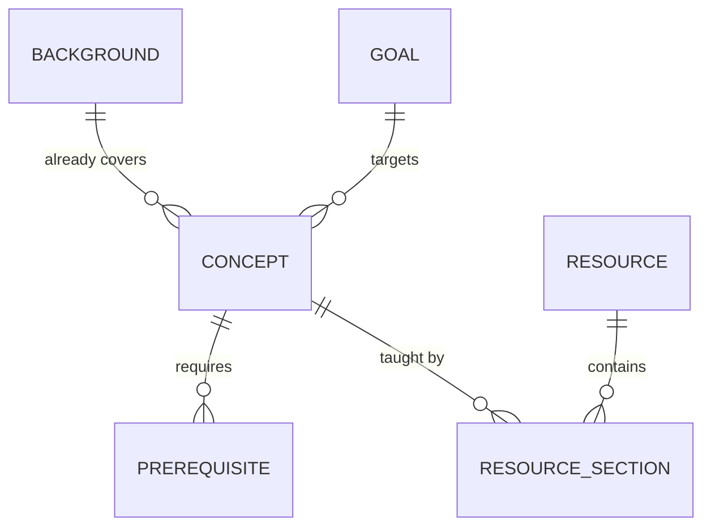
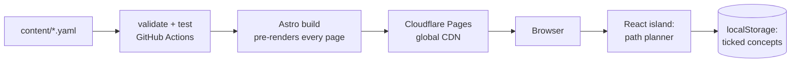
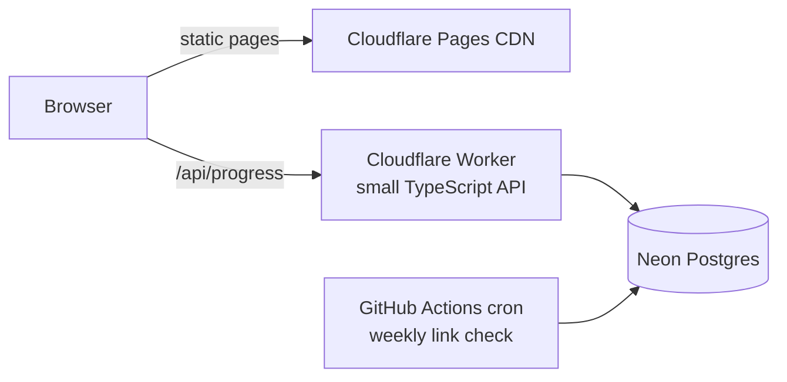

# Pregraph — System Design

> Status: v0 design, November 2026. This document is kept up to date as the project grows.
> Companion doc: [CONCEPTS.md](CONCEPTS.md) explains every technique used here and where to learn it.

## 1. Problem

Someone who already knows one field (say, mathematics) wants to learn another (computer science) on their own.
Free material is everywhere, but nobody tells them:

1. **what** to study, given what they already know,
2. **in what order**, and
3. **from where**, down to the chapter or lecture, not just "take this course".

Existing tools (roadmap.sh, OSSU, Learn Anything, teachyourselfcs.com) give one path for everyone.
Pregraph gives a path that **starts from your background**.

## 2. Product in one paragraph

You pick where you come from (e.g. *Maths graduate*) and where you want to go (e.g. *Core CS*).
Pregraph stores the field as a **graph of concepts with prerequisites**. It removes what your background already covers,
orders what's left so every concept comes after its prerequisites, and attaches the best free resource *sections* to each step.
You tick concepts off as you go; the plan updates instantly.

## 3. Scope

### v0 (this repo, first release)
- One transition, done well: **Maths → Computer Science**.
- Browse the concept graph and each concept's resources.
- Personal plan: mark what you know → ordered path with estimated hours.
- Progress saved in the browser (no login).
- Fast static site on a free CDN.

### Not in v0 (planned)
- Accounts and cross-device sync (v1).
- Weekly dead-link checker (v1).
- Adaptive "what do you already know?" diagnostic (v2).
- More transitions: Commerce → CS, Maths → Quant Finance, GATE CS syllabus view (v1–v2).
- Ratings and community contributions (v2).

### Non-goals
- Hosting course content. Pregraph links out; it never copies books or videos.
- Paid courses in the default path. Paid books may appear, clearly marked, as optional.

## 4. Requirements

| Type | Requirement | Target |
|---|---|---|
| Functional | Compute a valid, personal learning order | Every concept after all its hard prerequisites |
| Functional | Every concept has at least one free resource | Enforced at build time |
| Performance | First page load | < 1 s on 4G; HTML served from CDN edge |
| Performance | Re-plan after ticking a box | < 16 ms (one frame), in the browser |
| Cost | Hosting in v0 | ₹0 (domain optional, ~₹1,000/yr) |
| Reliability | Site stays up if any backend dies | Static pages need no backend |
| Quality | Broken content can't ship | CI fails on schema errors, cycles, dangling ids |

## 5. Data model

The content is the product, so the data model comes first. Content lives as YAML files in `content/`, reviewed through Git like code.



### Concept
A single learnable idea, small enough to study in 3–30 hours.

| Field | Example | Notes |
|---|---|---|
| `id` | `operating-systems` | kebab-case, unique, never renamed once published (URLs depend on it) |
| `title` | Operating Systems | |
| `area` | systems | groups concepts on screen and in ordering |
| `summary` | Processes, scheduling, memory, files… | one or two sentences |
| `hours` | 40 | rough study estimate |
| `requires` | `[c-and-memory, computer-architecture]` | **hard** prerequisites: must come first |
| `recommends` | `[shell-tools]` | **soft** prerequisites: ordering hint only, never pulled in |
| `resources` | list of resource sections | see below |

### Resource and resource section
A **resource** is a book, playlist, course or website. A **section** is the part of it that teaches one concept.

| Field | Example |
|---|---|
| `resource.id` | `ostep` |
| `resource.type` | book / video / course / site |
| `resource.free` | true |
| `section.locator` | "Part I: Virtualization (ch. 4–24)" |
| `section.role` | primary / alternative / deep-dive |
| `section.verified` | false until a human has checked the locator |

### Background
What a type of learner already knows. `maths-grad` covers `discrete-math` and `proofs` fully.
Backgrounds are just sets of concept ids, so adding a new one is a content change, not a code change.

### Goal
A set of target concepts, e.g. `core-cs = [algorithms, operating-systems, networking, databases]`.

## 6. The path engine

This is the core algorithm. It runs at build time (to pre-render the default path) **and** in the browser (to re-plan as you tick boxes). Same TypeScript code in both places.

### Inputs
- Graph `G = (V, E)`, an edge `u → v` meaning *u must be learned before v*.
- Goal set `T ⊆ V`.
- Known set `K ⊆ V` (from the background plus whatever you ticked).

### Step 1 — what do I still need? (backward search with pruning)
Start at every goal and walk **backwards** along hard prerequisite edges. When you reach a concept you already know, **stop** — don't walk into its prerequisites, because knowing it implies you're past them.

```
needed = {}
stack = T \ K
while stack not empty:
    v = pop(stack)
    if v in needed: continue
    needed.add(v)
    for u in hardPrereqs(v):
        if u not in K: push(stack, u)
```

Cost: O(V + E). The pruning is what makes the path *personal*: a maths graduate's walk stops at `discrete-math`, so nothing behind it shows up.

### Step 2 — in what order? (topological sort, Kahn's algorithm)
Take the subgraph induced by `needed`. Use both hard and soft edges *inside* it for ordering. Repeatedly pick a concept with no unfinished prerequisites.

When several concepts are ready at once, a deterministic tie-break keeps the plan stable and readable:
1. same `area` as the concept just placed (keeps topics together),
2. then fewer `hours` first (early wins keep people going),
3. then `id` alphabetically (stable output, testable).

Rule 1 depends on the last concept placed, so a fixed-priority heap doesn't fit. v0 scans the ready set each step: O(V² + E) worst case, which for a few hundred concepts is still well under a millisecond. If paths ever reach tens of thousands of concepts, switch to one heap per area.

If soft edges ever create a cycle inside `needed`, they are dropped and the order is recomputed with hard edges only. Hard edges can never cycle — the build forbids it (step 4).

### Step 3 — what can I start right now? (the frontier)
`frontier = { v ∈ needed : every hard prereq of v is in K }`.
The UI shows this as "Start here", so you're never stuck looking at a 60-step list.

### Step 4 — build-time checks (the content compiler)
`npm run validate` fails the build if:
- a YAML file breaks the schema (zod),
- an id is referenced but never defined (dangling edge),
- hard prerequisites contain a cycle (found with depth-first search; the error prints the cycle, e.g. `a → b → c → a`),
- a concept has no free primary resource,
- a background or goal names an unknown concept.

Bad content is caught in CI, never by a user.

## 7. Architecture

### v0 — fully static



- **Astro** turns content into plain HTML pages at build time: `/`, `/paths/maths-to-cs`, `/concepts/<id>`.
  Search engines can read them, and they load fast because there's nothing to compute on request.
- **React islands**: only the interactive planner ships JavaScript. The rest of the page is plain HTML. This is Astro's "islands architecture".
- **The graph is embedded** in the page as a small JSON blob (~20–50 KB for a few hundred concepts), so re-planning never touches the network.
- **No server, no database at request time.** Nothing to scale, nothing to fall over, ₹0.

### v1 — accounts and sync



- The API is tiny: sign in, `GET/PUT /api/progress`, ratings later.
- **Cloudflare Workers** run on the CDN edge with no idle sleep, avoiding the multi-second wake-up of free "always-on" hosts.
- **Neon** (free plan: 1 GB per project) suspends after ~5 idle minutes and resumes in a few hundred ms; only sign-in or sync waits on it, never page loads.
- localStorage stays the source of truth offline; on sign-in, local and server progress are merged (newest `updated_at` per concept wins).

## 8. Storage (v1)

Content stays in Git. Only user data goes in Postgres.

```sql
create table users (
  id          uuid primary key default gen_random_uuid(),
  email       text unique not null,
  created_at  timestamptz not null default now()
);

create type progress_status as enum ('known', 'in_progress', 'done');

create table progress (
  user_id     uuid not null references users(id) on delete cascade,
  concept_id  text not null,              -- matches content id; content is not in the DB
  status      progress_status not null,
  updated_at  timestamptz not null default now(),
  primary key (user_id, concept_id)
);

create table link_checks (
  url         text primary key,
  last_status int,
  last_ok_at  timestamptz,
  checked_at  timestamptz not null default now()
);
```

**Size estimate:** one `progress` row is about 60–100 bytes with index overhead.
10,000 users × 150 concepts = 1.5 million rows ≈ 150–200 MB. The free 1 GB lasts a long time.

## 9. Latency budget

| Action | Where it runs | Expected |
|---|---|---|
| Open any page | CDN edge cache | 20–80 ms to first byte |
| Tick a concept → new plan | Browser, in memory | < 1 ms compute, one frame to render |
| Load saved progress | localStorage | < 1 ms |
| Sync progress (v1) | Worker → Neon | 50–300 ms warm, + a few hundred ms on cold start; runs in the background |

## 10. Repository layout

```
pregraph/
├─ content/                 # the product: YAML, reviewed like code
│  ├─ concepts/*.yaml
│  ├─ resources.yaml
│  ├─ backgrounds.yaml
│  └─ goals.yaml
├─ src/
│  ├─ lib/
│  │  ├─ schema.ts          # zod schemas = the content contract
│  │  ├─ graph.ts           # graph building, cycle detection, path engine
│  │  └─ content.ts         # loads + validates YAML at build time
│  ├─ components/
│  │  └─ PathPlanner.tsx    # React island
│  ├─ layouts/Base.astro
│  └─ pages/                # index, paths/[slug], concepts/[id]
├─ scripts/validate.ts      # npm run validate
├─ tests/graph.test.ts      # vitest
├─ docs/
└─ .github/workflows/ci.yml
```

## 11. Milestones

| Week | Deliverable |
|---|---|
| 1 | Design docs, scaffold, engine + tests, sample content (this commit) |
| 2–3 | Full Maths → CS graph: ~80–150 concepts, every locator verified |
| 4 | Planner UI polish: frontier, hours, progress bar, "why is this here?" |
| 5 | Graph view (layered layout), concept pages, client-side search |
| 6 | Deploy to Cloudflare Pages; analytics; launch to first 50 users |
| 7–8 | Feedback fixes; second path (likely GATE CS view or Commerce → CS) |
| later | v1: Worker API, Neon, sign-in, link checker · v2: diagnostic |

## 12. Decisions

| Decision | Why | Revisit when |
|---|---|---|
| Static site, no backend in v0 | Free, fastest possible, nothing to break | Users ask for cross-device sync |
| Astro + React islands | HTML-first and SEO-friendly; React only where needed | Interactivity takes over most pages |
| Content as YAML in Git | Reviewable diffs, history, PRs for contributions, CI checks | Non-developers need to edit (then: an admin UI that writes the same files) |
| Same engine in build and browser | One implementation, one test suite | Engine needs data the browser can't have |
| Hard vs soft prerequisites | Hard edges decide what's *needed*; soft edges only nudge *order* — keeps paths short | — |
| Prune at known concepts | Personalisation for free; matches how experts reason | Diagnostic shows people over-claim knowledge |
| localStorage before accounts | Zero friction to try; no personal data to protect | v1 |

## 13. Risks

- **Curation effort** is the real cost. Mitigation: start with one path, `verified` flag on every locator, later let an AI draft and a human review.
- **Wrong prerequisites** make bad plans. Mitigation: small concepts, tests on the real graph, feedback button per step.
- **Link rot.** Mitigation: v1 weekly checker; prefer stable hosts (university sites, author sites, OCW).
- **"Why not just ask a chatbot?"** Answer: a reviewed, stable, checkable graph with progress tracking. A chatbot can be added on top to explain a concept, but the graph decides order and sources.

## 14. Open questions

- Licence for code (MIT?) and for content (CC BY-SA?).
- Should Indian sources (NPTEL, GATE syllabus mapping) be in v0 or the second path?
- How to estimate `hours` honestly — author guess now, real user data in v1.
